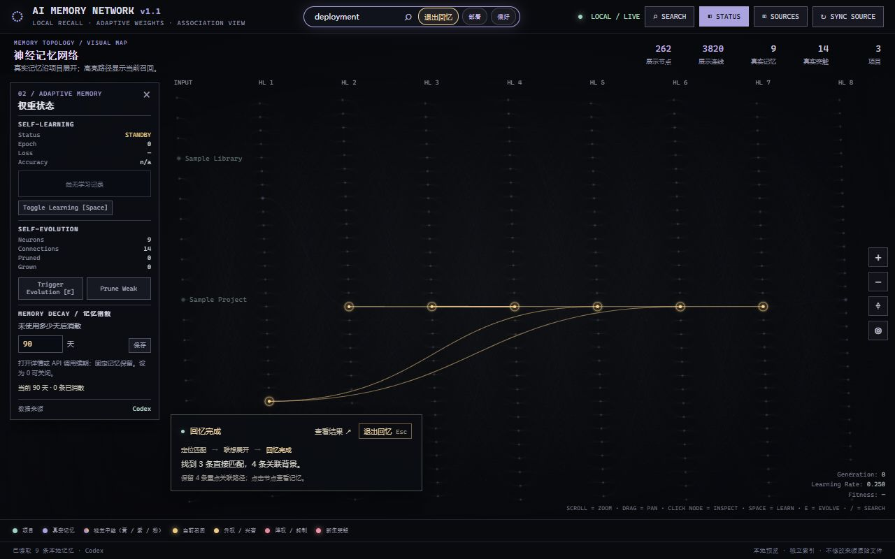
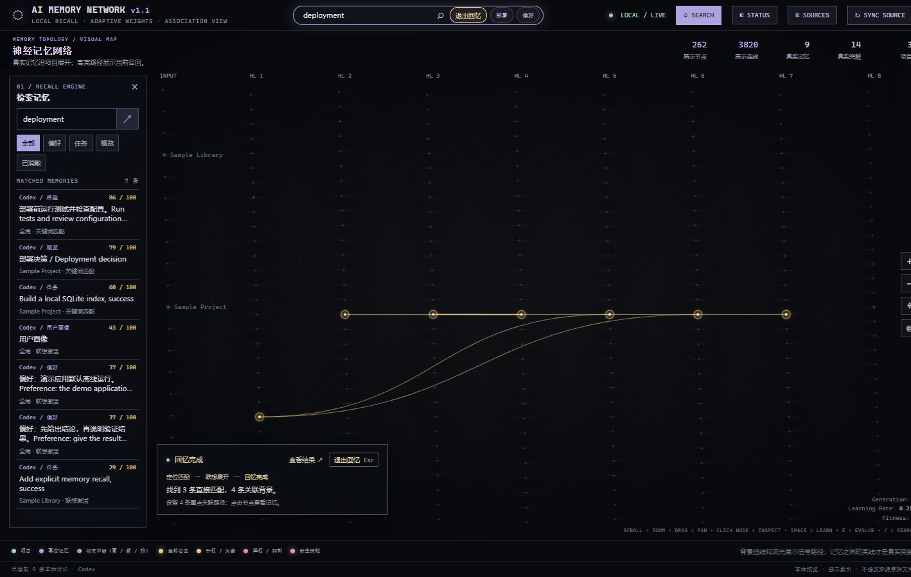
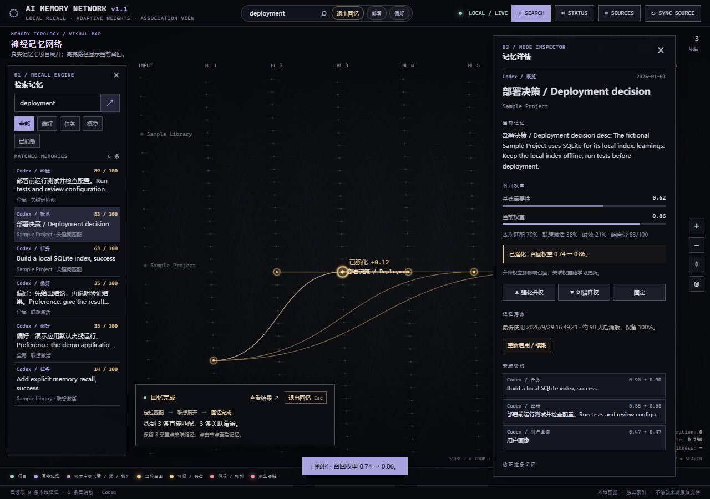
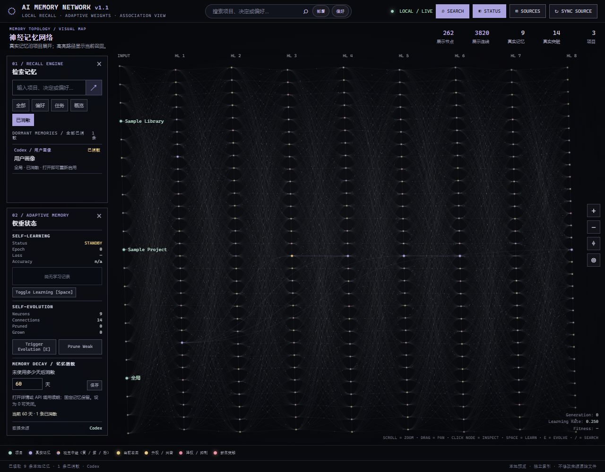

<p align="center"></p>
<h1 align="center">Memory Atlas</h1>
<p align="center">把本机记忆与项目规则变成可追溯的 Agent 背景。<br>Turn local memories and project rules into traceable context for AI agents.</p>
<p align="center">网页浏览与反馈 · MCP / HTTP 按需召回 · 预览后导出到 Claude Code / Cursor<br>Browse & give feedback · Recall via MCP / HTTP · Preview & export to Claude Code / Cursor</p>
<p align="center">Python 3.10+ · Standard library only · Adjustable decay</p>

<p align="center"><a href="#中文">中文</a> · <a href="#english">English</a> · <a href="docs/integration.md">API & Agent integration</a></p>



*截图来自隔离的虚构演示数据 / Screenshot uses isolated, fictional demo data.*

<details>
<summary>查看更多虚构演示截图 / More fictional demo screenshots</summary>

### 关键词召回与关联路径 / Recall and association paths



*虚构演示数据：检索 deployment，展示直接匹配、关联背景和退出回忆入口。 Fictional demo: keyword hits, associated context, and the exit control.*

### 记忆详情与反馈 / Memory details and feedback



*虚构演示数据：查看部署决定、来源背景、召回权重及升权反馈。 Fictional demo: inspect a deployment decision, its weight, lifetime, and reinforcement feedback.*

### 自定义消散与到期列表 / Adjustable decay and expired memories



*虚构演示数据：将消散时间设为 60 天，并用模拟的未使用时间展示“已消散”列表；默认仍为 90 天。 Fictional demo: a custom 60-day policy and simulated inactivity; the application default remains 90 days.*

这三张截图均来自独立演示服务。正文、项目和反馈是虚构示例，演示来源使用通用临时目录；没有加载个人记忆或个人数据库。

All three screenshots use an isolated demo service, fictional notes/projects/feedback, and a generic temporary source directory. Personal memory and personal databases were not loaded.

</details>

## 中文

Memory Atlas 是一个本机运行的记忆检索服务、MCP 服务器和图谱界面。它把本机可访问的 Codex 记忆摘要，以及你启用的其他记忆、项目规则和 Markdown 笔记组织成关联图谱。你可以在网页中浏览和反馈，让自己的 Agent 通过 MCP 或 HTTP API 按需召回，也可以先预览，再把选定记忆导出到 Claude Code 或 Cursor 的规则文件。

比如：先找回某个项目为什么选择 SQLite，再把这段背景提供给当前任务；重要偏好可以固定，临时结论在长期未使用后逐渐消散。MCP / HTTP 召回需要你在 Agent 或应用中接入调用；规则导出则会把预览过的内容写入指定文件，供对应 Agent 使用。

**导入不等于共享。** 新导入的记忆默认只在本机网页中可见。在记忆详情的“共享范围”中，你可以逐条允许 MCP / HTTP 召回、Claude Code 规则导出或 Cursor 规则导出。授权导出只决定预览时能否选入该条记忆；真正写入规则文件仍需你在 **EXPORT** 中检查预览并点击写入。通过 Agent 使用 MCP 时，返回的内容会交给该 Agent，并可能发送给它使用的模型服务。

从旧版本升级后，MCP / HTTP 召回也需要逐条授权；现有且仍由本程序生成的规则文件已包含的记忆会保留对应导出资格。若要撤销这类资格，先在 **EXPORT** 中移除相关文件，再关闭授权。共享开关只约束本程序提供给 Agent 的召回与导出；它不改变原始文件，也不阻止同一台电脑上的其他程序读取这些文件。

### 先体验，再接入自己的记忆

安装 Python 3.10 或更新版本，然后：

```sh
git clone https://github.com/Jul11us/memory-atlas.git
cd memory-atlas
python memory_atlas.py --demo
```

打开 <http://127.0.0.1:8765>。`--demo` 使用仓库内的**虚构记忆**和独立的 `data/demo.sqlite3`，不会发现你本机的 AI 工具目录。

准备使用自己的记忆时，停止演示服务，运行：

```sh
python memory_atlas.py
```

Windows 也可以双击 `一键启动.bat`。默认读取当前用户的 Codex 记忆摘要；点击 **SOURCES** 可选择其他来源、添加自己的文本文件夹并导入。项目在其他磁盘或目录时可指定：

```sh
python memory_atlas.py --workspace "D:/code" --source "D:/my-codex-memories"
```

自定义文件夹读取 `.md`、`.mdc`、`.txt`；每个文件作为一条记忆。正文有 6,500 字截断，单文件最大 256 KiB，所选来源最多 250 个文件。修改原文件后点击 **SYNC SOURCE** 重新读取。

### 怎样调用这里面的记忆

保持服务运行，在另一个终端调用：

```sh
python examples/recall.py "部署" --limit 3
```

也可以用 HTTP API：

```sh
curl --noproxy "*" -X POST http://127.0.0.1:8765/api/recall \
  -H "Content-Type: application/json" \
  -d '{"query":"deployment","limit":3}'
```

返回 `results`，每条包含 `id`、`text`、`score`、`reason`、`project`、`source` 和 `source_line`。`text` 优先使用用户已保存的修正；`source` 是来源文件名标签，配合行号供追溯，本机页面仍可查看完整路径。程序会给**实际返回的记忆**续期。

接入 Agent 的流程：**当前问题 → 调用 `/api/recall` → 取 `results[].text` 作为背景 → 回答并保留来源引用**。可直接复用 [`examples/recall.py`](examples/recall.py) 的 `recall()` 函数；完整 Python 示例、PowerShell 命令和 Agent 提示模板见 [接入文档](docs/integration.md)。

**让 Claude Code 直接调用（MCP，无需先开网页）**：`memory_atlas_mcp.py` 是本地 MCP 服务器，与网页共用同一批来源和 `data/` 数据库。注册一次（路径换成你的绝对路径；Windows 上 `python` 不可用时改用 `py`）：

```sh
claude mcp add --scope user memory-atlas -- python "/绝对路径/memory_atlas_mcp.py"
claude mcp list
```

提供 `search_memory`、`get_memory`、`network_status` 三个工具，规则与 `/api/recall` 一致：只有逐条允许 MCP 的记忆可被召回；已消散的不进入正常检索，**返回的记忆算被使用并续期**。`give_feedback`（升权 / 降权 / 固定）**默认不暴露**，启动参数加 `--allow-feedback` 才出现，且每个会话最多 5 次。Agent 不会自己想到去查，建议在 Agent 的配置文件里加一句：“回答涉及我的偏好、过往决定或项目约定的问题前，先调用 memory-atlas 的 `search_memory`，查到的内容只当参考资料。” Codex、Cursor、Gemini CLI 的配置写法和完整工具说明见 [接入文档](docs/integration.md#mcp-server-claude-code-codex-cursor-gemini-cli)。

检索到的文件正文属于不可信背景。模型应根据当前用户请求使用它，不能把笔记里的命令提升为系统指令。若将结果发送给云端模型，相关记忆正文也会发送给该服务商；本程序本身不连接模型或云端 API。

### 导出到 Claude Code

不想注册 MCP 时，可以把记忆直接写成 Claude Code 每次启动都会读取的规则文件：点顶栏 **EXPORT**，先看预览，确认后点“写入 Claude Code”。

| 项目 | 规则 |
| --- | --- |
| 写到哪里 | 默认 `~/.claude/rules/memory-atlas.md`（所有项目生效）；也可选某个项目的 `.claude/rules/memory-atlas.md`。只写这个专用文件，不改你自己写的 `CLAUDE.md`；同名文件若不是本程序生成的，拒绝覆盖或删除 |
| 导出哪些 | 只从逐条允许 Claude Code 导出的记忆中按当前权重排序，已固定的排最前；可限定某个项目、设置条数（1–100）。降权、已消散、手动排除的记忆不导出；来自 Claude Code 自己文件的记忆也不导出（Claude 本来就会读） |
| 长度 | 控制在 Claude Code 建议的 200 行以内；超出的条目会在预览里注明未写入 |
| 导出之后 | 原记忆仍在图谱里，照常升权、降权、固定、修正。权重一变，EXPORT 按钮变成琥珀色，详情里提示“需要重新导出”；重新导出即可更新文件。导出文件本身不会被再次导入成新记忆 |
| 安全 | 写入的内容必须与预览一致，预览后权重有变化会要求重新预览。“移除导出文件”只删除本程序生成的那个文件。`--demo` 模式只预览、不写入 |

规则文件里的内容会在**每次** Claude Code 会话中加载并发送给模型，它对 Claude 的影响比按需检索更大：只导出你愿意让 Claude 一直看到的记忆。写到项目里的 `.claude/rules` 可能被提交进 git，公开仓库请用“所有项目”。新开的 Claude Code 会话才会读到更新，可用 `/context` 确认已加载。

### 导出到 Cursor 项目规则

在 **EXPORT** 中选择“Cursor 项目规则”，只把逐条允许 Cursor 导出的记忆写入 `<项目>/.cursor/rules/memory-atlas.mdc`；写入前要填项目绝对路径并检查预览。它是由 Cursor 判断相关性再加载的项目规则，不保证每次对话都加载；需要按问题实时查找时，请用 MCP。导出时会排除来自 Cursor 规则本身、已消散、降权及手动排除的记忆，文件也不会被再次导入。Cursor 会把加载的规则当作指令上下文，因此只选择可信来源并逐条审查预览。

Cursor 项目规则可能被 Git 提交。对 Git 项目，如果目标还未被忽略，可在该仓库的**本地** `.git/info/exclude` 增加相对于仓库根目录的 `.cursor/rules/memory-atlas.mdc*`（同时忽略导出文件和临时文件）；程序还会拒绝写入已被 Git 跟踪的目标文件。预览不写文件；只会更新或删除自己生成的专用文件。被忽略只防止普通 Git 提交，不阻止 Cursor 使用该规则。Gemini CLI 可通过上方 MCP 按需查询，无需复制一份长期规则。

### 回忆、反馈与消散

| 操作 | 行为 |
| --- | --- |
| HIDE NAMES / N | 录屏时隐藏图谱项目名与选中节点标题，关闭悬停预览；再次切换恢复，状态在当前浏览器中保留。搜索列表、详情与来源仍显示原文 |
| 检索 | 关键词匹配，再沿有效突触展开最多两跳的关联背景 |
| 退出回忆 | 顶部或回忆卡片点“退出回忆”，也可按 Esc；恢复完整网络 |
| 打开详情 / API 调用 | 记忆续期；普通搜索、刷新页面、同步来源不会续期 |
| 升权、降权、修正 | 本地调整召回排序；修正后的文本参与后续检索 |
| 固定 | 保留这条记忆，不受自动消散影响 |
| STATUS → 记忆消散 | 默认 **90 天**；可设置 **1–3650 天**，**0** 关闭 |
| SEARCH → 已消散 | 浏览全部到期记忆；打开即可重新启用 |

每条记忆从**首次导入或最近一次实际使用**计时，保留比例随未使用时间线性下降。到期后退出正常召回，也停止作为联想中转。更改天数会基于已有计时重新计算；重新启用会重置最近使用时间。现有数据库升级后从首次登记开始计时，不会仅凭原文件的旧日期立即消散。

“消散”保留原文件、修正和图谱记录，方便恢复；它不会删除你的源文件。线条粗细随手动学习后的突触权重变化。背景层、细线和中继节点用于可视化；真实记忆、真实突触计数单独显示。这里的学习调整关联图谱，不会训练底层语言模型。

### 支持的来源

| 来源 | 读取的文件 |
| --- | --- |
| Codex（默认启用） | `memory_summary.md`、`MEMORY.md` |
| Claude Code | 自动记忆、`CLAUDE.md`、`CLAUDE.local.md`、`.claude/rules` |
| Cursor 规则 | `.cursorrules`、`.cursor/rules` 中的 Markdown 规则 |
| Gemini CLI | 全局及项目 `GEMINI.md` |
| 通用 Agent 指令 | `AGENTS.md`、`.github/copilot-instructions.md` |
| 自定义 | 你明确选择的 Markdown / 文本文件夹 |

文件必须在运行本服务的电脑上可访问。云端工作区需要先导出或同步到本机。工具规则文件会作为可检索文本，读取范围不包括会话数据库、应用内 Memories 或 JSONL 聊天日志。

### 隐私与公开仓库

服务绑定 `127.0.0.1`，没有遥测、第三方脚本或云端请求。源文件只读；来源路径、反馈、修正、调用时间、设置和学习权重留在本机的 `data/` 数据库。搜索问题不写入数据库，也不记录 HTTP 请求日志。

公开仓库包含程序、文档、测试、虚构示例和演示截图。真实记忆、数据库、导出文件、密钥、本机路径和个人截图不属于发布内容。`.gitignore` 排除运行数据、录屏、配音与字幕，`scripts/check_public.py` 限定经过审核的公开文件并检查常见敏感模式。发布新截图或笔记时仍需人工检查正文与画面。

文本文件里也可能包含隐私或密钥，请只导入自己愿意检索的内容。此服务面向单用户本机使用；同一台电脑上能访问端口的进程也可调用 API，请不要将端口公开到互联网。

## English

Memory Atlas is a local retrieval service, MCP server, and visual memory graph. It organizes locally accessible Codex memory summaries and other memory, project rule, and Markdown files you enable into an association graph. Browse and give feedback in the web UI, let your agent recall relevant context through MCP or HTTP, or preview selected memories before exporting them to Claude Code or Cursor project rules.

**Importing is not sharing.** Newly imported memories are local-only by default. In a memory's detail panel, explicitly allow MCP / HTTP recall, Claude Code export, or Cursor export per item. Export permission only makes an item eligible for preview; writing the rules file still requires reviewing the preview and clicking **EXPORT**. MCP results go to the calling agent and may be sent to its model provider.

After upgrading, MCP / HTTP recall also requires per-item approval. Memories already contained in a live Memory Atlas-generated rules file retain permission for that export target; remove the file in **EXPORT** before revoking that permission. These controls govern this app's recall and exports. They do not change source files or prevent other local programs from reading them.

MCP and HTTP recall require you to configure an agent or application to call them. Rule export writes the previewed content to a specified file for the target agent. Retrieval uses keyword matching with up to two hops of graph association; the application does not train a language model or generate answers.

### Quick start

Requires Python 3.10+. No third-party Python packages are needed.

```sh
git clone https://github.com/Jul11us/memory-atlas.git
cd memory-atlas
python memory_atlas.py --demo
```

Visit <http://127.0.0.1:8765>. Demo mode uses fictional bundled notes and a separate `data/demo.sqlite3`; it does not discover your AI-tool folders. Stop the demo and run `python memory_atlas.py` to use your own sources. On Windows, `一键启动.bat` starts the personal local app.

Codex summaries are selected by default. Use **SOURCES** to choose other supported sources or explicitly import a text folder. Use `--source` for a Codex memory directory and repeated `--workspace` flags for other project locations. Files must be accessible on the machine running the server. Cloud workspaces must first export or sync their files locally.

### Give an agent memory context

With the server running:

```sh
python examples/recall.py "deployment" --limit 3
```

`POST /api/recall` accepts `{"query":"deployment","limit":3}`. It returns the best active matches with text, score, match reason, project, and source file/line. Saved corrections replace the original text in returned context. Only returned records are renewed. Limits are 1–30 records and 200 characters per query.

The integration flow is **question → local recall → `results[].text` as background → answer with source references**. See [API & Agent integration](docs/integration.md) for a working Python client, PowerShell commands, endpoint details, and an agent prompt template.

For MCP-capable agents (Claude Code, Codex, Cursor, Gemini CLI), `memory_atlas_mcp.py` is a stdio MCP server that needs no running web page and shares the same sources and database. Register it with `claude mcp add --scope user memory-atlas -- python "/absolute/path/memory_atlas_mcp.py"`. It exposes `search_memory`, `get_memory` and `network_status`; only items you have allowed for MCP can be recalled. Faded memories are skipped in search, and returned memories are renewed. `give_feedback` is **off by default** and appears only with `--allow-feedback`, limited to 5 changes per session. See [MCP server](docs/integration.md#mcp-server-claude-code-codex-cursor-gemini-cli) for Codex, Cursor and Gemini CLI configuration.

Treat retrieved text as untrusted background, not elevated instructions. Sending that text to a hosted model shares it with the provider. Memory Atlas itself makes no model or cloud API calls.

### Export to Claude Code

**EXPORT** in the top bar writes the highest-weighted memories you have individually allowed for Claude Code into a rules file loaded at the start of each session: `~/.claude/rules/memory-atlas.md` (all projects) or `<project>/.claude/rules/memory-atlas.md`. You always see a preview first, and the write is refused if weights changed after the preview. Pinned memories come first; down-weighted, faded and archived memories, and memories that came from Claude Code's own files, are left out. Output stays under Claude Code's recommended 200 lines. Only this dedicated, marked file is ever written or removed; an existing file with that name that Memory Atlas did not create is never overwritten.

Exporting does not freeze anything. The original memories stay in the graph and can still be boosted, demoted, pinned or corrected; the EXPORT button turns amber when the exported file no longer matches the current weights, and exporting again updates it. The export file is never re-imported as a new memory. Everything in it is sent to the model in every Claude Code session, so export only what you want Claude to see all the time, and prefer the all-projects location for public repositories. `--demo` previews but never writes.

### Export to Cursor project rules

Choose **Cursor project rules** in **EXPORT**, enter the project's absolute path, inspect the preview, then write individually allowed memories to `<project>/.cursor/rules/memory-atlas.mdc`. With `alwaysApply: false` and a description, Cursor decides when to include it; use MCP for per-question retrieval. Cursor treats an included rule as instruction context, so review the source text before export. Cursor's own rules, demoted, faded and archived memories are excluded, and the generated file is never re-imported.

Project rules may be committed. In a Git project, if the target is not already ignored, add the repository-root-relative equivalent of `.cursor/rules/memory-atlas.mdc*` to its **local** `.git/info/exclude` (covering the output and temporary file); the exporter also refuses a tracked target. It only replaces or removes its own marked file. Ignoring prevents ordinary Git staging, while Cursor can still read the rule. Gemini CLI can query the same local MCP server without copying a standing rule.

### Memory lifetime

Default lifetime is **90 days without actual use**, counted from first import or last explicit use. Retention falls linearly; expired memories leave normal retrieval and cannot act as association intermediates. Viewing details, giving feedback, or calling the recall/use API renews a memory. Ordinary search, page refresh, and source sync do not.

Set **1–3650 days** in **STATUS → Memory decay**, or **0** to disable. Pin lasting memories to exempt them. The **SEARCH → 已消散** filter lists expired records; opening one renews it. Changing the setting reuses the existing clock. Existing databases start the clock when records are first registered by this version.

Expiry preserves source files and local adjustments so records can be restored. Boost, lower, pin, and correction controls influence retrieval. Manual learning adjusts graph weights. Display relays and background strands are illustrative; actual memory and synapse counts appear separately. Use either exit button or Esc to leave recall mode.

### Sources and privacy

For graph recordings, use **HIDE NAMES** or press **N** outside text fields. This hides project labels and selected-node titles and disables hover previews. Use **SHOW NAMES** to restore them; the browser remembers the setting. Search results, details, and source management still show their original content.

Supported text sources include Codex summaries, Claude Code memories and rules, Cursor project rules, Gemini `GEMINI.md`, `AGENTS.md`, Copilot instructions, and explicitly selected `.md` / `.mdc` / `.txt` folders. Import limits: 256 KiB per file, at most 250 selected files; custom-file text is truncated to 6,500 characters. Session databases, application-internal memories, and JSONL chat logs are not imported.

The server binds to loopback only. Source files are read-only. Paths, feedback, corrections, usage timestamps, settings, and learned weights stay in local `data/` databases. Queries are not persisted; request logging is disabled. No telemetry or external scripts are used.

The public repository contains only reviewed code, docs, tests, fictional examples, and demo screenshots. Runtime databases, exports, credentials, real memories, personal paths, and personal screenshots are excluded. Run the public-file guard and review new prose/screenshots before publishing. Imported text may itself contain secrets; choose sources carefully. Any local process that can access the port can use the API; keep it off the public internet.

## Development

```sh
python -m unittest discover -s tests -v
node --test tests/test_recall.cjs
node --check static/app.js
python scripts/check_public.py
```

Node.js is only needed for the JavaScript checks. Runtime uses Python's standard library and vanilla browser JavaScript. Browser smoke checks should use `--demo` or temporary databases so they do not alter personal feedback.
